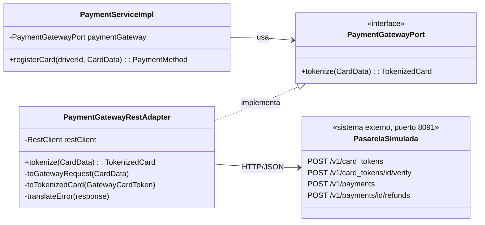
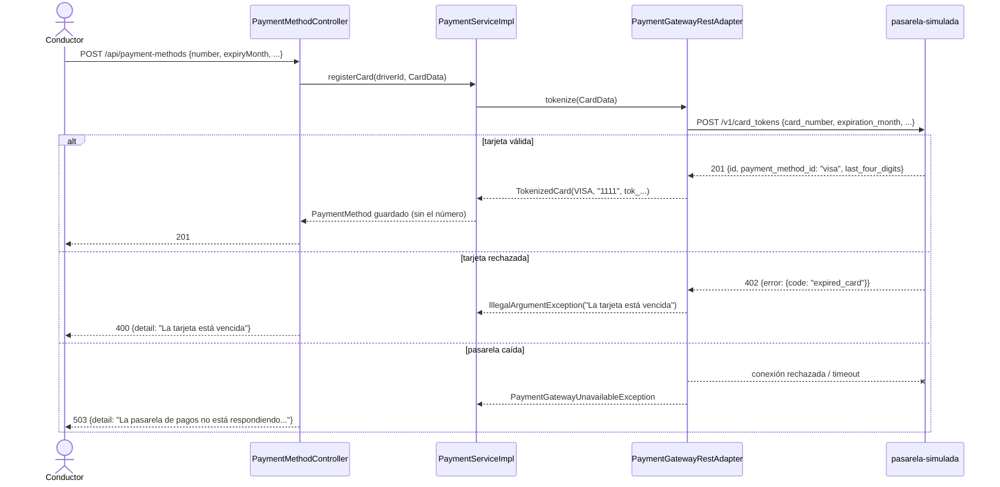

# Documentación de Patrón de Diseño: Adapter en la integración con la pasarela de pagos

**Materia:** Desarrollo de Aplicaciones II (3.4.218) — UADE  
**Equipo:** Grupo 12  
**Tareas Jira:** [ECO-50] Pasarela de pagos simulada como proceso aparte · [ECO-56] Patrón Adapter para la pasarela de pagos  

---

## 1. Identificación del Patrón

* **Patrón:** Adapter (Adaptador)
* **Clasificación:** Patrón Estructural (Gang of Four - GoF)
* **Componente / Módulo:** `PaymentService` en `ecopedia-integration`
* **Objetivo principal:** que el componente de Pagos trabaje contra una interfaz escrita en el idioma de Ecopedia, y que la conversión hacia y desde la API de un proveedor externo quede encerrada en una sola clase.

---

## 2. Contexto y Problema

Pagos necesita tokenizar tarjetas (RF02), y más adelante cobrar la seña (RF14), validar la tarjeta antes de habilitar un cargador y reintegrar. Todo eso lo resuelve un tercero: la pasarela de pagos, que desde ECO-50 corre como proceso aparte (`backend/pasarela-simulada`, puerto 8091), como pide RNF04.

La pasarela tiene su propia API, y no se parece a la nuestra:

| Ecopedia | Pasarela |
|----------|----------|
| `CardData.number`, con espacios o guiones, como lo copia el conductor | `card_number`, solo dígitos |
| `expiryMonth`, `expiryYear`, `holderName` (camelCase) | `expiration_month`, `expiration_year`, `cardholder.name` (snake_case) |
| `CardBrand.MASTERCARD` | `payment_method_id: "master"` |
| Importes en pesos, `BigDecimal` | Importes en centavos, entero (`amount: 150000`) |
| Rechazo: `IllegalArgumentException("La tarjeta está vencida")` → 400 con `ProblemDetail` | 402 con `{"error":{"type":"card_error","code":"expired_card"}}` |
| Acepta VISA, Mastercard y AMEX | Tokeniza también Diners y Discover |

### El problema arquitectónico

Si `PaymentServiceImpl` armara el JSON de la pasarela y leyera sus códigos de error, la lógica de negocio de Pagos quedaría escrita en el vocabulario de un proveedor. Cambiar de pasarela —o pasar de la simulada a una real— obligaría a reescribir el servicio y sus tests.

---

## 3. Solución Aplicada: Patrón Adapter

| Rol del patrón | Clase |
|----------------|-------|
| **Client** | `PaymentServiceImpl` |
| **Target** | `PaymentGatewayPort` (interfaz de dominio) |
| **Adapter** | `PaymentGatewayRestAdapter` |
| **Adaptee** | API REST de `pasarela-simulada` (`/v1/card_tokens`, `/v1/payments`) |

### Qué traduce el Adapter

1. **Pedido:** limpia el número (la pasarela solo acepta dígitos), renombra los campos y deja afuera lo que es solo de Ecopedia (la etiqueta de la tarjeta).
2. **Respuesta:** convierte `payment_method_id` en `CardBrand`. Una red que la pasarela acepta pero Ecopedia no sabe cobrar (Diners) se rechaza acá: qué marcas acepta la plataforma es una regla de negocio nuestra, no del proveedor.
3. **Errores:**
   * 402 `card_error` → `IllegalArgumentException` con un mensaje en castellano que el conductor puede usar para corregir el dato (→ 400).
   * 5xx, conexión rechazada, timeout o respuesta ilegible → `PaymentGatewayUnavailableException` (→ 503, "probá de nuevo en unos minutos").
   * 401/403 → también "no disponible" para el conductor; en el log queda que la clave del comercio está mal configurada.
   * Otro 4xx → `IllegalStateException`: armamos mal el pedido, es un error nuestro y tiene que verse como tal.

---

## 4. Diagrama de Secuencia: alta de una tarjeta

---

## 5. Justificación y Alternativas Descartadas

* **Llamar a la pasarela desde `PaymentServiceImpl`:** descartada. Mezcla negocio con el protocolo de un proveedor y hace imposible probar las reglas de RF02 sin la red.
* **Que la pasarela hable el idioma de Ecopedia:** descartada. En la realidad no elegimos la API del proveedor, y una pasarela simulada que copiara nuestros nombres haría que el Adapter no adapte nada.
* **Evidencia de que el patrón funciona:** antes de ECO-50 el puerto lo implementaba `LocalPaymentGateway`, en memoria. Reemplazarlo por el Adapter REST no cambió una línea de `PaymentServiceImpl` ni de sus tests.

---

## 6. Cómo probarlo

* `PaymentGatewayRestAdapterTest` (en `ecopedia-integration`): prueba la traducción en las dos direcciones contra un servidor simulado (`MockRestServiceServer`), sin levantar la pasarela.
* `GatewayApiTest` y `CardInspectorTest` (en `pasarela-simulada`): prueban que la pasarela conteste lo que el Adapter espera.
* A mano: `pnpm dev` levanta la pasarela junto con el resto. Tarjetas de prueba:
  * `4111 1111 1111 1111` (VISA), `5555 5555 5555 4444` (Mastercard), `3782 822463 10005` (AMEX): se aceptan.
  * `3056 930902 5904` (Diners): la pasarela la tokeniza, Ecopedia la rechaza.
  * `4000 0000 0000 9995`: se tokeniza, pero todo cobro se rechaza por fondos insuficientes (para la seña, ECO-53).
  * Con la pasarela apagada, el alta contesta 503.

---

## 7. Próximos pasos

La pasarela ya expone `/v1/card_tokens/{id}/verify`, `/v1/payments` (con clave de idempotencia `X-Idempotency-Key`) y `/v1/payments/{id}/refunds`. Cuando entren la seña (ECO-53), la validación de tarjeta (ECO-54) y el reintegro (ECO-59), se agregan `chargeDeposit`, `validateCard` y `refund` a `PaymentGatewayPort` y se implementan en el mismo Adapter, incluida la conversión de pesos (`BigDecimal`) a centavos.
