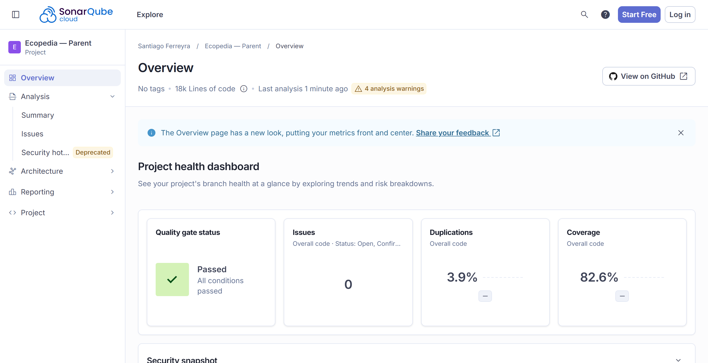

# QA-11 · Informe de ejecución y suite estable

Entregable 4 y eje B de los *Criterios de Testing y Aseguramiento de Calidad* (Clase 15). Todo lo
que sigue se midió sobre `main` en el commit `67f6388` (27/11/2026).

| Dónde | Qué corrió | Evidencia |
| --- | --- | --- |
| CI (GitHub Actions, Ubuntu, 4 núcleos) | Backend, frontend, asistente, API, contrato y E2E, **3 veces sobre el mismo commit** | [Run 46071168383](https://github.com/santiagoferreyraa/dai_2_tpo_grupo_12/actions/runs/46071168383), intentos 1, 2 y 3 |
| QA nocturno (GitHub Actions) | Carga (k6), mutation testing (PIT), ZAP, Trivy y gitleaks | [Run 46071168278](https://github.com/santiagoferreyraa/dai_2_tpo_grupo_12/actions/runs/46071168278) |
| Máquina del equipo (Windows 11, JDK 21.0.4, Maven 3.9.16, Docker 29.7, 12 núcleos) | `mvn verify` 3 veces seguidas, el asistente 3 veces y las 11 pruebas *live* | Reportes de Surefire y Failsafe de cada corrida |

## 1. Totales por nivel

| Nivel | Herramienta | Ejecutados | Pasados | Fallados | Bloqueados |
| --- | --- | ---: | ---: | ---: | ---: |
| Unitarias y de componente (4 backends y 3 simuladores) | JUnit 5, Spring Boot Test | 881 | 881 | 0 | 0 (11 salteados en `verify`, corridos aparte: 1.1) |
| Integración con contenedores (PostgreSQL y Artemis reales) | Testcontainers, `*IT` | 23 | 23 | 0 | 0 |
| Integración contra la distribuidora simulada (*live*) | JUnit 5, a pedido | 11 | 11 | 0 | 0 |
| Asistente del conductor | `node --test` | 75 | 75 | 0 | 0 |
| API | Postman + Newman | 114 pedidos, 225 aserciones | 225 | 0 | 0 |
| Contrato contra el OpenAPI de los 4 módulos | Schemathesis 4.34.2 | 56 operaciones, ~2.590 casos generados | todas | 0 | 0 |
| Punta a punta en el navegador | Playwright (Chromium) | 5 escenarios | 5 | 0 | 0 |
| Carga | k6, 50 usuarios, 5 min | 44.663 pedidos | 44.663 | 0 | 0 |
| **Total de tests** (sin contar k6 ni los casos generados) | | **1.165** | **1.165** | **0** | **0** |

El total suma 881 + 23 + 11 + 75 + 114 + 5 + 56: Newman cuenta por pedido (sus 225 aserciones
están adentro de esos 114) y Schemathesis por operación.

### 1.1 Los 11 bloqueados de `mvn verify`, y por qué no quedan bloqueados

En `mvn verify` hay 11 tests salteados: `PowerGridLiveTest` (7, en integration) y
`PowerGridFeasibilityLiveTest` (4, en charging). No son `@Disabled`: tienen
`@EnabledIfSystemProperty(power-grid.live)` porque necesitan procesos levantados (la
distribuidora simulada en el 8087, y para la regla de potencia también core e integration) que
el job de CI no levanta. Están justificados en el Javadoc de cada clase.

Para que no queden sin correr, el 27/11 los corrimos aparte contra esos procesos con el perfil
`local`:

```bash
mvn -pl backend/ecopedia-integration test -Dtest=PowerGridLiveTest -Dpower-grid.live=true
mvn -pl backend/ecopedia-charging test -Dtest=PowerGridFeasibilityLiveTest -Dpower-grid.live=true
```

Resultado: 11 de 11. Por eso figuran como "Integración *live*" y no como bloqueados.

### 1.2 Detalle por módulo (backend)

| Módulo | Unitarias | `*IT` | Salteados en `verify` |
| --- | ---: | ---: | ---: |
| ecopedia-core | 207 | 4 | 0 |
| ecopedia-charging | 378 | 8 | 4 |
| ecopedia-integration | 159 | 5 | 7 |
| ecopedia-async | 93 | 6 | 0 |
| Simuladores (pasarela, distribuidora, cargadores) | 44 | 0 | 0 |
| **Total** | **881 (+11)** | **23** | **11** |

## 2. Suite estable: 3 corridas seguidas

El criterio pide que la suite corra 3 veces seguidas con resultado idéntico. Lo verificamos en
los dos lugares donde corre:

**En CI**, el mismo commit relanzado dos veces más (intentos 2 y 3 del mismo run):

| Job | Intento 1 | Intento 2 | Intento 3 |
| --- | --- | --- | --- |
| Backend (Maven) | 915 tests, 0 fallas, 11 salteados · 5 min 52 s | idéntico · 5 min 26 s | idéntico · 6 min 13 s |
| API (Newman + Schemathesis) | 114 / 225, 0 fallas · 56 operaciones, 2.598 casos, 0 fallas | idéntico · 2.574 casos, 0 fallas | idéntico · 2.571 casos, 0 fallas |
| E2E (Playwright) | 5 de 5 · 12,4 s | 5 de 5 · 20,8 s | 5 de 5 · 17,7 s |
| Agent (Node) | 75 de 75 | 75 de 75 | 75 de 75 |
| Frontend (pnpm) | formato, lint y build en verde | idéntico | idéntico |

**En la máquina del equipo**, `mvn verify` tres veces seguidas: 345 s, 319 s y 308 s, las tres en
`BUILD SUCCESS`. Comparamos test por test (módulo, clase, método y estado) los 915 de cada
corrida: **0 diferencias entre las tres**. El asistente, 75 de 75 las tres veces.

**Tests inestables: 0.** Playwright tampoco marcó ningún escenario como *flaky* (reintento que
pasa).

Que Schemathesis genere una cantidad de casos distinta en cada intento no es inestabilidad: usa
la semilla fija `20261125`, pero cuántos casos arma depende de lo que responde la API (por
ejemplo, si un recurso ya existe), y la colección de Newman corre antes y deja datos. Las
operaciones probadas (56) y el resultado (0 fallas) son los mismos en las tres.

### 2.1 `@Disabled` y tests que no corren

| Qué | Cantidad | Justificación |
| --- | ---: | --- |
| `@Disabled` en backend y simuladores | 0 | — |
| `test.skip` / `test.fixme` / `.only` en Playwright | 0 | — |
| Tests salteados en el asistente | 0 | — |
| `@EnabledIfSystemProperty` (los *live*) | 11 | Necesitan procesos levantados; corridos aparte, 11 de 11 (1.1) |
| `RequiresDocker` (los `*IT`) | 23 | Se saltean solo en una máquina **sin** Docker; en CI la falta de Docker es una falla, no un salteo. En las 6 corridas se ejecutaron los 23 |

## 3. Cobertura (JaCoCo)

El umbral está en el `pom.xml` y lo controla `mvn verify` en cada módulo: **80 % de líneas y 70 %
de ramas**; si un módulo queda debajo, el check "Backend (Maven)" falla. Quedan afuera los
paquetes `contract` (las clases que genera JAXB a partir del WSDL y el XSD).

| Módulo | Líneas | Ramas | Umbral |
| --- | ---: | ---: | --- |
| ecopedia-core | 95,1 % | 82,7 % | Cumple |
| ecopedia-charging | 90,3 % | 75,6 % | Cumple |
| ecopedia-integration | 92,3 % | 75,4 % | Cumple |
| ecopedia-async | 95,7 % | 79,1 % | Cumple |
| **Total backend** | **92,5 %** (5.950 de 6.431) | **77,7 %** (1.230 de 1.584) | Cumple |

**Lo que no se mide.** El frontend no tiene tests unitarios: se cubre con los 5 escenarios de
Playwright y con lint y build en cada PR. El asistente tiene sus 75 tests, pero sin reporte de
cobertura.

## 4. Mutation score (PIT)

PIT muta las clases de dominio (`com.ecopedia.*.domain.*`) de los 4 backends y corre los tests
unitarios contra cada mutante (los `*IT` y los *live* quedan afuera, porque dependen de
procesos externos). El umbral es **60 %** (`mutationThreshold` en el `pom.xml`) y corre en el QA
nocturno, en cada push a `main` y todas las noches.

| Módulo | Mutantes | Muertos | Sobreviven | Sin cobertura | Mutation score |
| --- | ---: | ---: | ---: | ---: | ---: |
| ecopedia-core | 88 | 81 | 6 | 1 | 92,0 % |
| ecopedia-charging | 206 | 183 | 9 | 14 | 88,8 % |
| ecopedia-integration | 92 | 75 | 10 | 7 | 81,5 % |
| ecopedia-async | 117 | 104 | 1 | 12 | 88,9 % |
| **Total** | **503** | **443** | **26** | **34** | **88,1 %** |

"Muertos" incluye 1 mutante de charging que mató por tiempo (`TIMED_OUT`). Si se cuentan solo
los mutantes que algún test ejecuta (sin los 34 sin cobertura), la fuerza de los tests es
94,5 %. El módulo más flojo es integration: sus 10 sobrevivientes están en `PendingPayment` (7)
y `DepositCharge` (3), el dominio de los cobros pendientes y la seña. En charging, 5 de los 9 están
en `Booking`. Son los primeros lugares para sumar aserciones.

## 5. Tiempos

| Qué | Tiempo | Límite |
| --- | --- | --- |
| Pipeline de cada PR (CI, los 5 jobs en paralelo) | 5 min 26 s a 6 min 13 s, lo marca el job Backend | < 15 min (eje B): cumple |
| `mvn verify` en la máquina del equipo | 5 min 08 s a 5 min 45 s | — |
| API: Newman | ~4,5 s | — |
| API: Schemathesis (4 módulos) | ~1 min | — |
| E2E: 5 escenarios | 12 a 21 s | — |
| Asistente: 75 tests | 3 a 5 s | — |
| QA nocturno completo | 7 min 37 s (el más largo es PIT, 7 min 33 s) | Fuera del pipeline del PR, a propósito |
| Carga (k6) | 5 min de carga + arranque | — |

Los `*IT` de async son los más lentos del backend (31 s): levantan un Artemis real para probar
la reentrega y la cola de mensajes muertos.

## 6. Performance (k6)

Escenario de QA-06 (`qa/k6/load-critical.js`): **50 usuarios concurrentes durante 5 minutos**
sobre los 3 endpoints del camino del conductor que reserva. Cada usuario es un conductor
distinto, así las retenciones no compiten entre sí. Criterio (eje C): **p95 < 500 ms y menos de
1 % de errores**; si no se cumple, k6 termina con error y el job queda en rojo.

| Endpoint | Mediana | p90 | p95 | Máximo | Umbral p95 |
| --- | ---: | ---: | ---: | ---: | --- |
| `GET /api/search` (core) | 0,97 ms | 2,37 ms | 3,52 ms | 659 ms | Cumple |
| `GET /api/bookings/availability` (charging) | 1,47 ms | 3,27 ms | 4,53 ms | 724 ms | Cumple |
| `POST /api/bookings/holds` (charging) | 1,40 ms | 3,24 ms | 4,57 ms | 387 ms | Cumple |
| **Todos** | **1,29 ms** | **3,06 ms** | **4,37 ms** | **724 ms** | **Cumple** |

44.663 pedidos en 5 minutos (145 por segundo), **0 % de errores**, y los 44.562 chequeos de
respuesta (200, 200 y 201) en verde. Los máximos de 400 a 700 ms son casos aislados: el p95
queda por debajo de 5 ms en los tres endpoints.

Medido en el runner de GitHub del QA nocturno del 27/11: 4 núcleos compartidos entre los 4
backends, los simuladores y k6. El mismo script corre en el QA nocturno en cada push a `main`.

## 7. Casos de prueba y trazabilidad

De los 53 casos de `qa/jira/casos.csv` (QA-03), 51 tienen un test automatizado que corrió en
verde en las tres corridas. Los otros dos:

| Caso | Estado | Qué falta |
| --- | --- | --- |
| TC-45 · Catálogo de core caído al retener | Manual, sin test automatizado | Se prueba apagando core en vivo |
| TC-52 · Broker caído al confirmar | Automatizado a medias: `BookingWithoutBrokerTest` cubre que la reserva se confirma igual | El reenvío al volver el broker (DEF-01, resuelto) se probó en vivo |

## 8. Quality Gate

Proyecto en SonarCloud:
[santiagoferreyraa_dai_2_tpo_grupo_12](https://sonarcloud.io/project/overview?id=santiagoferreyraa_dai_2_tpo_grupo_12).

Desde el 28/11 el job `Sonar (Quality Gate)` de CI ([#105](https://github.com/santiagoferreyraa/dai_2_tpo_grupo_12/pull/105))
analiza cada PR y cada push a `main`. Corre `mvn verify`, así Sonar recibe la cobertura de JaCoCo,
y después el escáner, que espera el resultado del Quality Gate y pone el job en rojo si no pasa.
Analiza los 4 backends y los 3 simuladores. Además, SpotBugs y PMD siguen corriendo dentro de
`mvn verify` (QA-17, G3) y bloquean el merge desde el check "Backend (Maven)".

El Quality Gate es "Sonar way", sobre el código nuevo: calificación A en confiabilidad, seguridad
y mantenibilidad, 80 % de cobertura, a lo sumo 3 % de líneas duplicadas y el 100 % de los
*security hotspots* revisados.



**Estado de `main`** (`fcedfef`, 28/11): Quality Gate aprobado, con todas sus condiciones en
verde. Hay 0 bugs, 0 vulnerabilidades y 0 code smells; la calificación es A en confiabilidad,
seguridad y mantenibilidad, y están revisados el 100 % de los *security hotspots*. Sobre todo el
código, la duplicación es de 3,9 % y la cobertura de 82,6 % en 18.254 líneas. Esa cobertura es más
baja que la de la sección 3 (92,5 %) porque SonarCloud cuenta también los 3 simuladores, que no
generan reporte de JaCoCo. Sobre el código nuevo, que es lo que evalúa el Quality Gate, la
cobertura es de 90,4 % y la duplicación de 0 %.

### 8.1 Qué encontró el primer análisis y qué se hizo

El primer análisis de `main` (28/11) marcó 11 hallazgos. Así quedó cada uno:

| Hallazgo | Regla | Tratamiento |
| --- | --- | --- |
| La regex del nodo de la distribuidora (`StationRequest`) desbordaba la pila con unos 20 KB de entrada: `POST /api/stations` respondía 500 | S5998 | **Defecto real, corregido** en [#106](https://github.com/santiagoferreyraa/dai_2_tpo_grupo_12/pull/106), con prueba de regresión (`InputLimitsTest#hugeGridNode`) |
| El `sessionId` de la URL iba al log sin limpiar (`stopSession`) | S5145 | **Defecto real, menor, corregido** en #106: se loguea el id guardado |
| `@Transactional(readOnly)` ignorado por una llamada interna (`PaymentServiceImpl`) | S2229 | Corregido en #106 |
| 3 regex con retroceso en tests | S8786 | Corregido en #106 (JsonPath) |
| CSRF desactivado en los 4 `SecurityConfig` | S4502 | Falso positivo: API sin estado, token Bearer en `Authorization`, sin cookies. Justificado una vez en `pom.xml` |
| `UPDATE` sin `WHERE` en la migración `V202611101800` | — | Es a propósito (completa el código de acceso de todos los conectores) y una migración aplicada no se edita. El job de Maven no analiza SQL; solo lo había marcado el *Automatic Analysis* |

Después del #106, el Quality Gate de `main` falló por 4 % de duplicación en el código nuevo. Venía
de `SecurityConfig` y `OpenApiConfig`, que el #107 cambió en los 4 backends y que se repiten a
propósito: cada backend se despliega solo y no comparten código. Se sacaron del cálculo de
duplicación en [#109](https://github.com/santiagoferreyraa/dai_2_tpo_grupo_12/pull/109), con el
porqué en el `pom.xml`. Siguen analizándose por bugs y seguridad, y el resto del código se sigue
midiendo como siempre.

## 9. Pendientes de este informe

| Pendiente | Quién lo destraba |
| --- | --- |
| Repetir las 3 corridas sobre el commit del tag `v1.0-final` (QA-14) | Antes del 07/12; los números de las secciones 1 a 6 son de `67f6388` |
